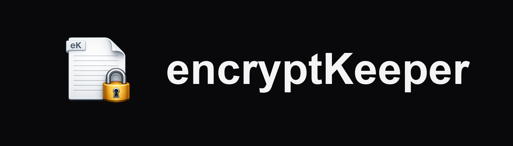
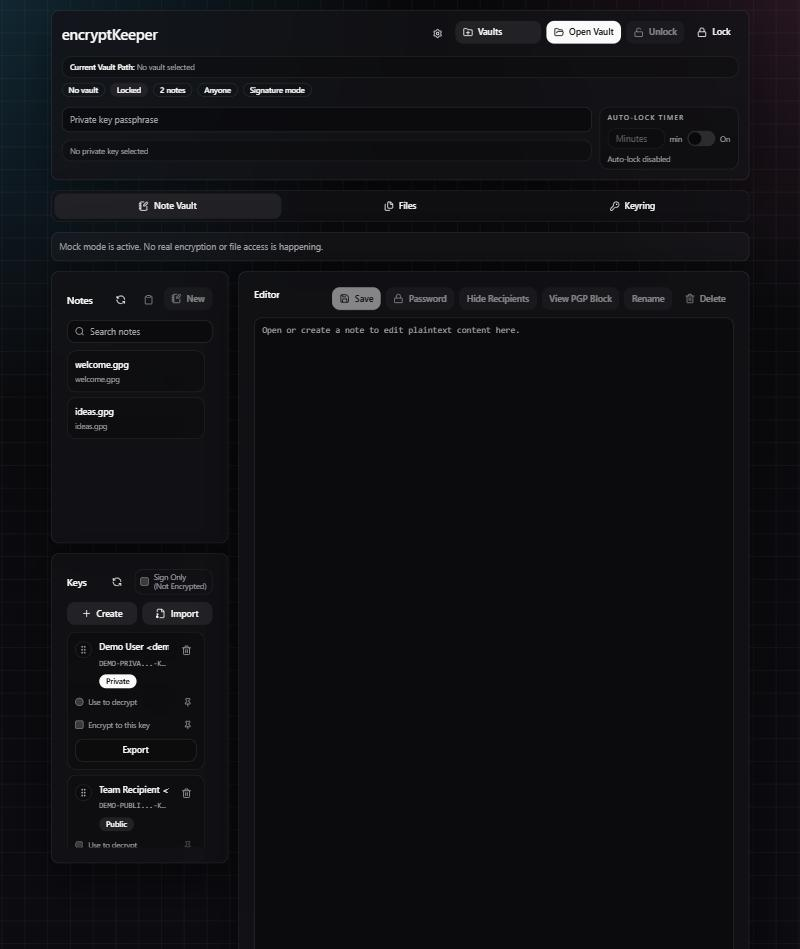

<p align="center">
  
</p>

<h3 align="center"><b>encryptKeeper</b></h3>

<p align="center">Desktop app for managing encrypted .gpg text notes in a folder vault.</p>

<p align="center">
  
</p>

---

encryptKeeper is a Windows desktop workspace for OpenPGP and S/MIME work, built with [Tauri](https://tauri.app), React, and GnuPG. It started as an encrypted note editor and now covers three working areas:

- **Note Vault**: encrypted notes stored as `.gpg` files in a folder vault or a ZIP archive vault
- **Files**: encrypt, decrypt, sign, and verify arbitrary files and folders with OpenPGP or S/MIME
- **Keyring**: OpenPGP keys, X.509 certificates, trust management, and hardware token workflows

Everything runs locally. Cryptography is delegated to your installed GnuPG (`gpg` and `gpgsm`), and decrypted material is handled in secure temporary storage.

## Features

### Note Vault

- Open folder vaults and ZIP archive vaults
- Save vault paths, pin them, and reopen them later (archive-aware, with vault-type badges)
- Create, open, edit, rename, save, refresh, search, and delete encrypted notes
- Encrypt notes to selected recipients, sign them, or protect them with a symmetric password
- Inspect note recipients and verify note signatures when a note opens
- Import notes from clipboard text, PGP blocks, and detached-signature flows
- Auto-save after idle, auto-lock after a configurable timeout, and optional hiding of note names while locked

### Files

- Encrypt, decrypt, sign, and verify arbitrary files
- Verify detached signatures
- Queue files and folders together and choose output targets explicitly
- Batch folder jobs preserve the relative folder structure in their output
- Switch between `OpenPGP` and `S-MIME` workflows
- Reuse the selected key and recipient state from the sidebar

### Keyring

- Browse OpenPGP keys and X.509 certificates in one workspace
- Inspect identities, fingerprints, capabilities, subkeys, certifications, trust, and validation state
- Import keys and certificates from files, pasted text, the clipboard, WKD lookup, or public keyserver search
- Export public keys, private keys, and combined material; export PKCS#12 and PKCS#8 for X.509
- Create OpenPGP keys (choose the algorithm) and X.509 certificates (self-signed)
- Manage key expiry, ownertrust, passphrases, subkeys, certifications, and revocation certificates
- Manage X.509 trust roots, view validated chains, import CRLs, and export or import trust snapshots
- Review import summaries and duplicate handling for recently imported keys

### OpenPGP

- Local key generation
- Recipient selection for note and file encryption
- Detached and inline signature workflows
- Public keyserver lookup, publish, refresh, and full sync
- WKD and auto-discovery lookup
- Revocation certificate export
- Ownertrust import and export
- Passphrase rotation for existing secret keys
- Certification visibility for signed user IDs

### X.509 / S/MIME

- Self-signed X.509 certificate creation
- Certificate import from file or pasted certificate text
- Certificate export, plus private material export through PKCS#12 and PKCS#8
- S/MIME encrypt, decrypt, sign, and detached verify in the `Files` tab
- Validated chain view with a compact validation summary
- CRL import
- Trust-root mark and unmark through the local trust list
- Passphrase changes for certificates that hold private material

### Hardware Tokens

- Smartcard and token status panel in `Keyring`
- Restart the smartcard service
- Change the token PIN
- Fetch the linked public key from card metadata
- Sync local shadow stubs
- Generate on-card key material by slot and algorithm
- Store local OpenPGP key material onto the card
- Factory reset, behind an explicit confirmation

### Preferences And Activity

- Collapsible **Recent Activity** feed
- **Show Recent History** setting to hide the feed entirely
- Auto-lock timeout and auto-save controls
- Clipboard integration (**Use Clipboard**) for pasted PGP content
- **Recursive scan** for nested folders
- **Hide Note Names** to keep note names private while locked
- Optional display of recipients and PGP blocks when a note opens

## Requirements

For end users:

- Windows 10 or 11
- [GnuPG](https://gnupg.org/download/) with `gpg` and `gpgsm` on your `PATH`
- A smartcard reader and the GnuPG smartcard service, only if you use hardware tokens

For building from source:

- [Node.js](https://nodejs.org/) (v18 or newer)
- [Rust](https://rustup.rs/) with the MSVC toolchain
- Tauri's Windows prerequisites (WebView2 and the Visual Studio C++ build tools)
- GnuPG, as above

## Getting Started From Source

Install the JavaScript dependencies:

```powershell
npm install
```

Check that the environment is ready:

```powershell
npm run check:env
```

Run the desktop app in development mode:

```powershell
npm run tauri:dev
```

Outside Tauri (for example in a plain browser at `http://localhost:1420`), the UI runs against a built-in mock backend. The mock shows a banner and performs no real encryption.

## Building The Installer

Create the production build and Windows installers:

```powershell
npm run tauri:build
```

The installers are written to `src-tauri/target/release/bundle/`:

- `nsis/` for the NSIS `.exe` setup
- `msi/` for the Windows Installer `.msi`

## Testing

Run the frontend tests:

```powershell
npm test
```

Run the Rust tests:

```powershell
cargo test --manifest-path src-tauri/Cargo.toml
```

Type-check and build the frontend bundle:

```powershell
npm run build
```

## Project Layout

| Path | Purpose |
| --- | --- |
| `src/` | React + TypeScript UI (`App.tsx`, shared components, API bridge) |
| `src/lib/` | Frontend API bridge, mock backend, and helpers |
| `src-tauri/src/` | Rust backend: commands, vault, crypto, key manager, and session services |
| `src-tauri/tauri.conf.json` | App metadata, window settings, and installer configuration |
| `docs/images/` | README images |

## Release Notes

See [CHANGELOG.md](CHANGELOG.md) for the full version history. The current version is **1.0.0**.
